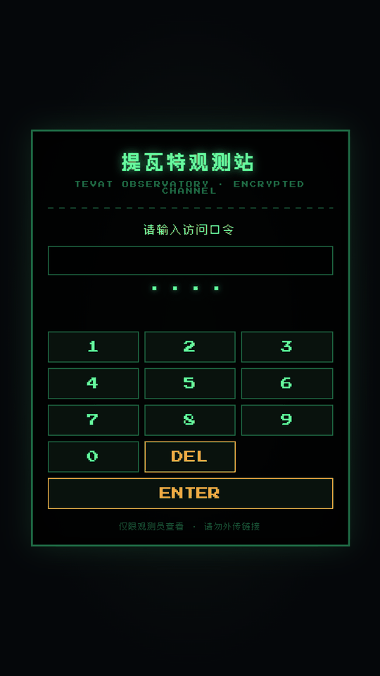
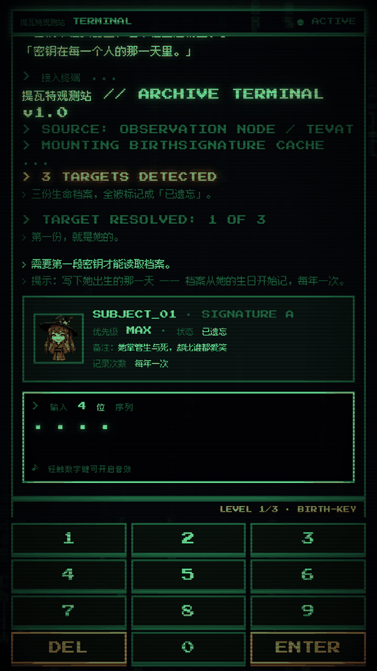
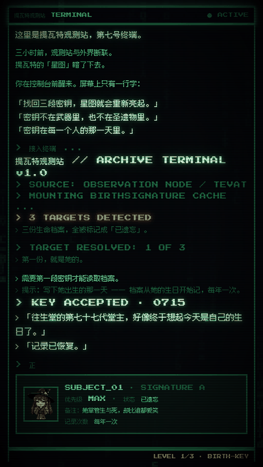
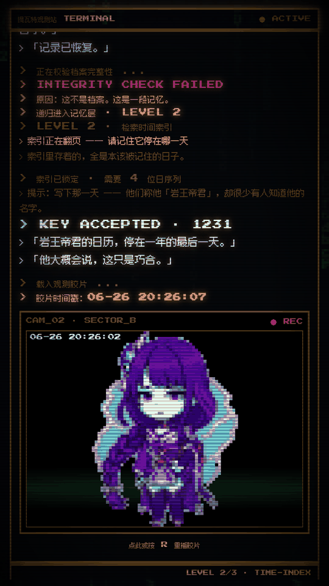

# 提瓦特观测站 · TEVAT OBSERVATORY

> 8-bit CRT 终端解谜站 · 三层密钥 · three.js 星空终局

一个纯前端的互动解谜网页：你是观测站的记录员，在一台老式终端前找回三段密钥，让熄灭的「星图」重新亮起。

零依赖构建、零后端、零配置 —— 克隆下来用任意静态服务器打开 `index.html` 就能玩。

**在线试玩：<https://7jjawzgi9d6hp.space.mcode.cn>**
（访问口令 `0928`；这是客户端校验的口令，看源码即可获得，作用只是挡住"随手点开"的人。）

| 口令门 | Level 1 档案卡 | 终局 · 祈愿结果条 |
|---|---|---|
|  |  |  |

| Level 2 时间索引 | Level 3 观测胶片 |
|---|---|
|  |  |

---

## 亮点

- **CRT 终端叙事**：字符雨背景、扫描线、打字机逐字输出、WebAudio 芯片音效，全套 8bit 终端质感
- **三层递进解谜**：档案卡片 → 翻页日历 → 观测胶片，每层的线索载体都不同
- **反转结构**：你以为在解密，其实是在"叫回名字"
- **终局**：three.js 星空 + 六位角色立绘漂浮 + 祈愿结果条 + 可点击放烟花
- **全响应式**：手机 / 平板 / 桌面都做过布局验收，角色立绘按 DOM 实测占位动态排布，任何视口比例都不重叠
- **密码可自定义**：改四个常量就能换成自己的故事

---

## 玩法流程

```
访问口令（4 位） → 序章 → L1 档案卡片 → L2 翻页日历 → L3 观测胶片 → 终局星空
```

| 环节 | 线索载体 | 要做的事 |
|---|---|---|
| 访问口令 | 数字键盘 | 输入 4 位口令进入 |
| Level 1 | 人物档案卡片 | 找出角色，写下她出生的那一天（月+日，4 位） |
| Level 2 | 时间索引日历 | 日历会自己翻页，记住它停在的那一天 |
| Level 3 | 观测胶片 | 从胶片时间戳里取出月和日，写满四位 |

> 三层密钥凑齐后，终端会自己揭示答案 —— 密码从来不是日期。

### 密码一览（剧透）

| 环节 | 答案 | 依据 |
|---|---|---|
| 访问口令 | `0928` | 提瓦特公测日 2020-09-28 |
| Level 1 | `0715` | 胡桃的生日 |
| Level 2 | `1231` | 钟离的生日 |
| Level 3 | `0626` | 雷电将军的生日 |

### 角色

| 角色 | 生日 | 密钥 | 站位 |
|---|---|---|---|
| 胡桃 | 7 月 15 日 | 0715 | L1 档案卡 · 祈愿结果条 |
| 钟离 | 12 月 31 日 | 1231 | L2 日历 · 祈愿结果条 |
| 雷电将军 | 6 月 26 日 | 0626 | L3 胶片 · 祈愿结果条 |
| 甘雨 | 12 月 2 日 | — | 终局星空 |
| 纳西妲 | 10 月 27 日 | — | 终局星空 · 终局记录卡 |
| 芙宁娜 | 10 月 13 日 | — | 终局星空 |

---

## 快速开始

```bash
# 任选一种静态服务器
python -m http.server 8899
npx serve .
```

打开 <http://127.0.0.1:8899/index.html>，输入访问口令 `0928` 即可。

> 直接双击 `index.html` 也能开，但 `file://` 下部分浏览器会拦截字体与贴图加载，建议用本地服务器。

### 本地调试快捷入口

在**本地 / 内网**访问时，URL 加参数可直接跳到指定关卡（公网域名不生效）：

| 参数 | 效果 |
|---|---|
| `?finale` | 直接进终局 |
| `?lvl2` | 直接进 Level 2 |
| `?lvl3` | 直接进 Level 3 |
| `?auto` | 跳过开场点击，自动开始 |

---

## 改成你自己的故事

四个常量，改完就能换成完全不同的谜题：

| 要改什么 | 改哪里 |
|---|---|
| 访问口令 | `js/lock.js` 里的 `const PASS = '0928'`（同时改 `LEN`） |
| 三层密钥 | `js/terminal.js` 里 `gate('...', 4, '0715', ...)` 的第三个参数 |
| 线索文案 | `js/terminal.js` 的 `phase1 / phase2 / phase3` |
| 终局角色 | `js/finale.js` 的 `FLOAT_ITEMS`（贴图路径 + 相对高度 `rel`）+ `index.html` 的 `#fin-strip` |

换掉角色贴图时，请保持 **透明背景 PNG**，并在 `js/finale.js` 里同步 `FLOAT_ITEMS` 的 `src`。
终局立绘的排布会读取每张贴图的真实宽高比自动计算，所以不同尺寸的立绘混排也不会被拉扁。

---

## 目录结构

```
.
├── index.html              # 单页入口（终局结构、密码门、开场逻辑都在这里）
├── css/style.css           # CRT 终端 / 卡片 / 日历 / 胶片 / 终局全部样式
├── js/
│   ├── lock.js             # 访问密码门（客户端校验）
│   ├── terminal.js         # 序章 + 三层解谜 + 反转（全部叙事文案在这）
│   ├── finale.js           # three.js 星空 / 立绘漂浮 / 烟花
│   ├── audio.js            # WebAudio 芯片音效引擎
│   └── devhost.js          # 本地调试白名单（只认回环与内网）
├── assets/
│   ├── sprite/             # 六张角色像素立绘（透明 PNG）
│   └── fonts/              # Press Start 2P + Fusion Pixel 子集 + OFL 许可证
├── vendor/three.min.js     # three.js（MIT）
└── tools/                  # 验收脚本（Playwright）
```

---

## 验收脚本

`tools/` 下是开发期用的自动化验收，需要本机装有 Playwright：

```bash
node tools/check_e2e.js             # 端到端通关：口令 → 三层 → 终局
node tools/check_layout.js          # 五个视口的终局布局（出界 / 重叠 / 压字）
node tools/capture_story.js         # 整条故事线分镜截图
node tools/audit_teaser_leak.js     # 预告片泄密审计：逐帧取可见文本，与密钥串对撞
node tools/capture_teaser.js        # 预告片分镜抓帧（自带四层泄密防护）
python tools/build_font_subset.py   # 重建中文像素字体子集
python tools/stage_deploy.py        # 生成发布暂存目录（并自检无开发中间物）
```

脚本默认指向 `http://127.0.0.1:8900`，用环境变量 `SITE_URL` 覆盖。
`check_e2e.js` / `check_layout.js` 里的访问口令需要跟 `js/lock.js` 保持一致。
`capture_teaser.js` 的抓帧输出目录用环境变量 `TEASER_WORK` 指定。

### 预告片泄密防护

预告片里**不允许出现任何一段密钥**，也不能出现能反推密钥的画面。
`capture_teaser.js` 里有四层防护：

1. 删掉直接回显密钥的终端行（`KEY ACCEPTED` / 带值的胶片时间戳 / 指向 12/31 的台词）
2. 藏掉胶片画面上的时间戳覆盖层
3. 日历停靠日若为 12/31，改成中性的 11/29
4. 兜底：`#out` / `#stage` / `#term-foot` 再扫一遍密钥串，命中就抹掉

`audit_teaser_leak.js` 则是**独立的验收方**：重放同一条流程，逐帧取页面可见文本，
与密钥串、以及「一年的最后一天」「20:26」「12-31」这类等价表述对撞，命中即失败。

---

## 部署

纯静态站点，把整个目录丢到任意静态托管即可：

```bash
# 例：GitHub Pages / Cloudflare Pages / Netlify / Vercel
# 入口是仓库根目录的 index.html
```

部署到公网时记得把 `js/lock.js` 里的访问口令改掉 —— 它是**客户端校验**，写在前端源码里，看源码即可获得。
它只挡"随手点开"的人，真正的访问控制要靠平台侧的密码保护或鉴权。

---

## 素材与授权

### 代码

MIT License，见 [LICENSE](LICENSE)。

### 第三方依赖

| 组件 | 用途 | 授权 |
|---|---|---|
| [three.js](https://threejs.org/) | 终局星空与烟花 | MIT |
| [Press Start 2P](https://fonts.google.com/specimen/Press+Start+2P) | 拉丁字符像素字体 | SIL OFL 1.1 |
| [Fusion Pixel Font](https://github.com/TakWolf/fusion-pixel-font) | 中文字素字体（12px 网格，本仓库为子集） | SIL OFL 1.1，许可证见 `assets/fonts/OFL-FusionPixel.txt` |

### 角色立绘

`assets/sprite/*.png` 是**根据角色外形特征描述、用 AI 生成的原创 8-bit 像素画**，不是任何官方素材的复制、抠图或二创改绘。

### 免责声明

本项目是**非官方的同人 / 致敬作品**，与 miHoYo / 米哈游及《原神》官方无任何关联、未经其授权或认可。

《原神》相关角色名称、设定、美术与相关知识产权归 miHoYo / 米哈游所有。
本仓库仅用于技术学习与非商业的同人创作，请勿用于任何商业用途，也请勿将仓库内的素材视为官方资源分发。

---

## 技术栈

原生 HTML / CSS / JavaScript + three.js，无构建步骤、无 npm 依赖。
音效为 WebAudio 实时合成（芯片音乐），不加载任何音频文件。

---

## License

代码 MIT；字体与贴图各自遵循其原始授权，详见 [THIRD-PARTY-NOTICES.md](THIRD-PARTY-NOTICES.md)。

---

作者：[Hugong](https://github.com/hujinlong989)
